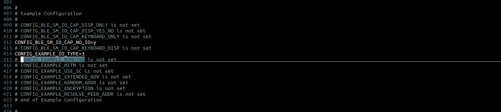
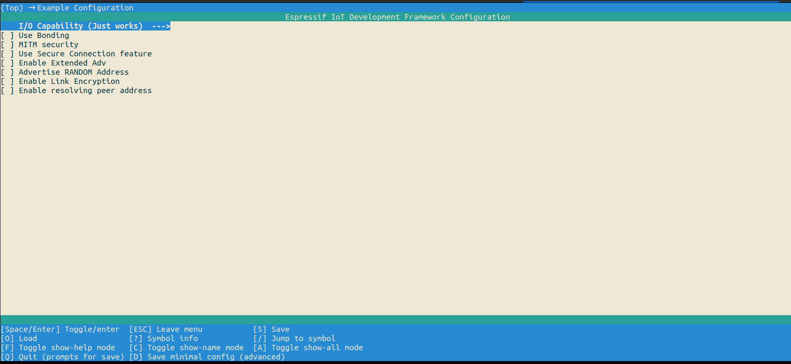

# BLE 从机(Peripheral)示例详解

> 本文档是 ESP-IDF `examples/bluetooth/nimble/bleprph/tutorial/bleprph_walkthrough.md` 的中文译本,基于 **ESP-IDF v6.0.1**。
> 代码中的注释一并译为中文,函数名、宏名、API 名称保持原文以便对照头文件。
> 译文中以 `译者注` 标记的段落是原文没有、为方便本项目理解而补充的内容。

---

## 简介

本教程讲解乐鑫芯片上 BLE 从机(peripheral)示例代码。该示例旨在帮助你理解:
GATT 数据库的配置、GATT 读/写事件的处理、订阅(subscribe)事件的处理,
以及广播(advertisement)和 SMP 相关的 NimBLE API。
它同时演示了 NimBLE 协议栈的安全特性 —— 诸如设备的 I/O 能力、
绑定(Bonding)标志、MITM 保护标志、仅安全连接(Secure Connection Only)模式、
启用链路加密等 SMP 参数,都可以通过 menuconfig 选项进行配置。

---

## 头文件包含(Includes)

本示例位于 ESP-IDF 的 examples 目录下的 [bleprph/main](../main)。
main 目录中的 [main.c](../main/main.c) 包含了我们要讲解的全部功能。`main.c` 中包含的头文件有:

这些 `include` 是 FreeRTOS 及底层系统组件运行所必需的,其中包括日志功能,
以及一个用于在非易失性 flash 中存储数据的库。
我们重点关注的是 `nimble_port.h`、`nimble_port_freertos.h`、`ble_hs.h`、
`ble_svc_gap.h` 和 `bleprph.h`,它们暴露了实现本示例所需的 BLE API。

* `nimble_port.h`:包含 NimBLE 协议栈初始化所需函数的声明。
* `nimble_port_freertos.h`:初始化并启动 NimBLE 主机任务(host task)。
* `ble_hs.h`:定义了处理主机(host)事件的相关功能。
* `ble_svc_gap.h`:定义了设备名、设备外观(appearance)相关的宏,并声明了设置它们的函数。
* `bleprph.h`:包含两个结构体 `ble_hs_cfg` 和 `ble_gatt_register_ctxt` 的前置声明,
  同时定义了 GATT 服务器各服务(service)与特征(characteristic)的 UUID。

---

## 程序入口

程序的入口是 `app_main()` 函数:

```c
void
app_main(void)
{
    int rc;

    /* 初始化 NVS —— 它用于存储 PHY 校准数据 */
    esp_err_t ret = nvs_flash_init();
    if (ret == ESP_ERR_NVS_NO_FREE_PAGES || ret == ESP_ERR_NVS_NEW_VERSION_FOUND) {
        ESP_ERROR_CHECK(nvs_flash_erase());
        ret = nvs_flash_init();
    }
    ESP_ERROR_CHECK(ret);

    ret = nimble_port_init();
    if (ret != ESP_OK) {
        ESP_LOGE(tag, "Failed to init nimble %d ", ret);
        return;
    }
    /* 初始化 NimBLE 主机配置 */
    ble_hs_cfg.reset_cb = bleprph_on_reset;
    ble_hs_cfg.sync_cb = bleprph_on_sync;
    ble_hs_cfg.gatts_register_cb = gatt_svr_register_cb;
    ble_hs_cfg.store_status_cb = ble_store_util_status_rr;

    ble_hs_cfg.sm_io_cap = CONFIG_EXAMPLE_IO_TYPE;
#ifdef CONFIG_EXAMPLE_BONDING
    ble_hs_cfg.sm_bonding = 1;
    /* 使能相应的掩码位,确保需要的密钥会被交换 */
    ble_hs_cfg.sm_our_key_dist |= BLE_SM_PAIR_KEY_DIST_ENC;
    ble_hs_cfg.sm_their_key_dist |= BLE_SM_PAIR_KEY_DIST_ENC;
#endif
#ifdef CONFIG_EXAMPLE_MITM
    ble_hs_cfg.sm_mitm = 1;
#endif
#ifdef CONFIG_EXAMPLE_USE_SC
    ble_hs_cfg.sm_sc = 1;
#else
    ble_hs_cfg.sm_sc = 0;
#endif
#ifdef CONFIG_EXAMPLE_RESOLVE_PEER_ADDR
    /* 存储 IRK */
    ble_hs_cfg.sm_our_key_dist |= BLE_SM_PAIR_KEY_DIST_ID;
    ble_hs_cfg.sm_their_key_dist |= BLE_SM_PAIR_KEY_DIST_ID;
#endif

    rc = gatt_svr_init();
    assert(rc == 0);

    /* 设置默认设备名 */
    rc = ble_svc_gap_device_name_set("nimble-bleprph");
    assert(rc == 0);

    /* XXX 需要一个 store 模板 */
    ble_store_config_init();

    nimble_port_freertos_init(bleprph_host_task);

    /* 初始化命令行接口,以接收用户输入 */
    rc = scli_init();
    if (rc != ESP_OK) {
        ESP_LOGE(tag, "scli_init() failed");
    }
}
```

main 函数首先初始化非易失性存储(NVS)库。该库让我们可以把键值对保存到 flash 中。
`nvs_flash_init()` 会存储 PHY 校准数据。在 BLE 设备中,用于加密和认证的密钥
通常也存放在 NVS 里。BLE 会把对端密钥(peer keys)、CCCD 键值、对端记录等存入 NVS。
把这些密钥存进 NVS 后,BLE 设备在需要时可以快速取回,而不必经历耗时的密钥生成过程。

```c
esp_err_t ret = nvs_flash_init();
if (ret == ESP_ERR_NVS_NO_FREE_PAGES || ret == ESP_ERR_NVS_NEW_VERSION_FOUND) {
    ESP_ERROR_CHECK(nvs_flash_erase());
    ret = nvs_flash_init();
}
ESP_ERROR_CHECK( ret );
```

---

## 蓝牙控制器与协议栈初始化

main 函数调用 `nimble_port_init()` 来初始化蓝牙控制器和 NimBLE 协议栈。
该函数首先创建名为 `esp_bt_controller_config_t` 的配置结构体
(使用 `BT_CONTROLLER_INIT_CONFIG_DEFAULT()` 宏生成的默认设置)来初始化蓝牙控制器。
它在控制器一侧实现了主机控制器接口(HCI)、链路层(LL)和物理层(PHY)。
蓝牙控制器对用户应用是不可见的,它负责处理 BLE 协议栈的下层。
控制器配置包括设置蓝牙控制器栈大小、优先级以及 HCI 波特率。
配置准备好之后,通过 `esp_bt_controller_init()` 和 `esp_bt_controller_enable()`
两个函数来初始化和使能蓝牙控制器:

```c
esp_bt_controller_config_t config_opts = BT_CONTROLLER_INIT_CONFIG_DEFAULT();
ret = esp_bt_controller_init(&config_opts);
```

接下来,控制器以 BLE 模式被使能:

```c
ret = esp_bt_controller_enable(ESP_BT_MODE_BLE);
```

如果你想使用 BLE 模式,控制器就应当在 `ESP_BT_MODE_BLE` 下使能。

共支持四种蓝牙模式:

1. `ESP_BT_MODE_IDLE`:蓝牙未运行
2. `ESP_BT_MODE_BLE`:BLE 模式
3. `ESP_BT_MODE_CLASSIC_BT`:经典蓝牙模式
4. `ESP_BT_MODE_BTDM`:双模(BLE + 经典蓝牙)

蓝牙控制器初始化完成后,再通过 `esp_nimble_init()` 初始化 NimBLE 协议栈
(其中包含 BLE 的通用定义与 API):

```c
esp_err_t esp_nimble_init(void)
{

#if !SOC_ESP_NIMBLE_CONTROLLER
    /* 初始化 OS 移植用的函数指针 */
    npl_freertos_funcs_init();

    npl_freertos_mempool_init();

    if(esp_nimble_hci_init() != ESP_OK) {
        ESP_LOGE(NIMBLE_PORT_LOG_TAG, "hci inits failed\n");
        return ESP_FAIL;
    }

    /* 初始化默认事件队列 */
    ble_npl_eventq_init(&g_eventq_dflt);

    os_msys_init();

    void ble_store_ram_init(void);
    /* XXX 需要一个 store 模板 */
    ble_store_ram_init();
#endif

    /* 初始化主机(host) */
    ble_hs_init();
    return ESP_OK;
}
```

主机的配置,是通过设置若干回调来完成的。这些回调分别在以下时机执行:
协议栈复位、协议栈同步、每个 GATT 资源(服务、特征或描述符)注册时,
以及持久化操作无法执行或即将失败时。

```c
ble_hs_cfg.reset_cb = bleprph_on_reset;
ble_hs_cfg.sync_cb = bleprph_on_sync;
ble_hs_cfg.gatts_register_cb = gatt_svr_register_cb;
ble_hs_cfg.store_status_cb = ble_store_util_status_rr;
```

---

## 安全管理器(Security Manager)配置

安全管理器(即 `sm_` 系列成员)可在运行时配置,以便简化安全相关的测试。
其默认值通过在 menuconfig 中为本示例选择相应选项来设定。

### I/O 能力(I/O CAPABILITIES)

```c
/* 安全管理器本地输入输出能力,设为 3 表示既无输入也无输出 */
ble_hs_cfg.sm_io_cap = CONFIG_EXAMPLE_IO_TYPE;
```

### 启用绑定(USE BONDING)

```c
#ifdef CONFIG_EXAMPLE_BONDING
    /* 若在配对中设置了相应标志,配对请求/响应就会被设置。
     * 这会使得绑定过程中分发的密钥被保存下来 */
    ble_hs_cfg.sm_bonding = 1;

    /* 使能相应的掩码位,确保需要的密钥会被交换 */
    ble_hs_cfg.sm_our_key_dist |= BLE_SM_PAIR_KEY_DIST_ENC;   /* 安全管理器本地密钥分发掩码 */

    ble_hs_cfg.sm_their_key_dist |= BLE_SM_PAIR_KEY_DIST_ENC; /* 安全管理器远端密钥分发掩码 */
#endif
```

`CONFIG_EXAMPLE_BONDING` 用于在 bleprph 上启用绑定。默认该标志是关闭的。
可以通过 sdkconfig 文件或 menuconfig 选项进行配置。
下面是相应的截图。





### MITM 保护(MITM PROTECTION)

```c
#ifdef CONFIG_EXAMPLE_MITM
    ble_hs_cfg.sm_mitm = 1;
#endif
```

当配对过程中设置了 `CONFIG_EXAMPLE_MITM` 标志,它会置位配对请求中 auth req 字段的
MITM 位,从而要求配对过程具备防中间人(Man-In-The-Middle)攻击的保护能力。
该标志同样可以通过 sdkconfig 或 menuconfig 配置。

### 安全连接特性(SECURE CONNECTION FEATURE)

```c
#ifdef CONFIG_EXAMPLE_USE_SC
    ble_hs_cfg.sm_sc = 1;
#else
    ble_hs_cfg.sm_sc = 0;
#endif
```

当在配对请求/响应中设置了 `CONFIG_EXAMPLE_USE_SC` 标志,只要远端设备也支持,
就会启用 LE Secure Connections 进行配对。如果远端设备不支持 LE 安全连接,
配对过程会回退到传统配对(legacy pairing)。

### 启用对端地址解析(ENABLE RESOLVING PEER ADDRESS)

```c
#ifdef CONFIG_EXAMPLE_RESOLVE_PEER_ADDR
    /* 存储 IRK */
    ble_hs_cfg.sm_our_key_dist |= BLE_SM_PAIR_KEY_DIST_ID;
    ble_hs_cfg.sm_their_key_dist |= BLE_SM_PAIR_KEY_DIST_ID;
#endif
```

上面这段代码表示在配对过程中分发身份解析密钥(IRK)。
IRK 用于蓝牙的设备地址解析过程,它允许设备把一个可解析私有地址
(resolvable private address)与某个公开身份(IRK)关联起来。
这提升了隐私性 —— 仅凭设备地址就很难对设备进行追踪。
这里设置的就是 SMP 配对第三阶段所分发的密钥。

---

## GATT 服务器初始化(GATT SERVER INIT)

```c
    rc = gatt_svr_init();
    assert(rc == 0);
```

`gatt_svr_init` 函数在 BLE 应用的初始化阶段被调用,用于建立 GATT 服务器,
并定义它所支持的服务与特征。

> **译者注:** 这是整个示例里**你最需要动手改的地方**。
> 该函数内部通过 `ble_gatts_count_cfg()` 和 `ble_gatts_add_svcs()` 把一张
> 服务和特征的定义表注册进协议栈。你自己加服务时,改的就是那张表。

---

## 设置设备名

main 函数调用 `ble_svc_gap_device_name_set()` 来设置默认设备名。
本示例把 `nimble-bleprph` 作为默认设备名传入。

```c
rc = ble_svc_gap_device_name_set("nimble-bleprph");
```

---

## BLE Store 配置

main 函数调用 `ble_store_config_init()` 来配置主机,它会设置一组存储回调,
用于处理安全材料(security material)的读取、写入和删除。

```c
/* XXX 需要一个 store 模板 */
    ble_store_config_init();
```

---

## 线程模型(THREAD MODEL)

main 函数通过 `nimble_port_freertos_init()` 创建一个任务,让 NimBLE 在其中运行。
它通过 `esp_nimble_enable()` 使能 NimBLE 协议栈。

```c
nimble_port_freertos_init(bleprph_host_task);
```

`esp_nimble_enable()` 会创建一个运行 NimBLE 主机的任务。
NimBLE 协议栈运行在独立的线程中,拥有自己的上下文,
以便处理来自控制器的异步操作,并向控制器投递 HCI 命令。

> **译者注:** 这一点在带 OLED、多任务的工程里非常关键。
> NimBLE 的所有回调(包括 GAP 事件、GATT 读写)**都跑在这个 host task 里**,
> 所以回调里绝对不能做耗时操作(比如刷 OLED、写 flash、等信号量)。
> 正确做法是只往 FreeRTOS 队列里塞数据,把实际处理丢给你的业务任务。

---

## 设置命令行接口

```c
  rc = scli_init();
    if (rc != ESP_OK) {
        ESP_LOGE(tag, "scli_init() failed");
    }
```

为了初始化一个能接收用户输入的命令行接口(CLI),使用了 `scli_init()` 函数。
该函数注册了 CLI 命令 `key <value>`,用于在配对过程中接收用户输入。
配对流程是通过 `ble_register_cli()` 函数来配合完成的。

---

# 从机广播(PERIPHERAL ADVERTISEMENT)

1. 很多应用都使用从机广播来从应用层启动广播。`bleprph` 示例就提供了这个广播功能。
   它使用下面这个函数来启动广播。
2. `bleprph_advertise` 首先创建 `ble_gap_adv_params` 和 `ble_hs_adv_fields` 两个结构体的实例。
3. 广播参数 —— 比如连接模式、可发现模式、广播间隔、信道图(channel map)、
   广播过滤策略,以及定向广播的高占空比模式 —— 都在这些结构体中定义。
4. `ble_hs_adv_fields` 提供了一个在 BLE 应用中存放广播数据的结构体。
   它包含多种数据成员,例如标志位(指示广播类型及其他通用信息)、
   广播发射功率、设备名,以及 16 位服务 UUID(例如警报通知服务)等。

下面是启动广播的实现:

```c
static void
bleprph_advertise(void)
{
    struct ble_gap_adv_params adv_params;
    struct ble_hs_adv_fields fields;
    const char *name;
    int rc;

    /**
     *  设置我们广播中包含的广播数据:
     *     o 标志位 (指示广播类型及其他通用信息)
     *     o 广播发射功率
     *     o 设备名
     *     o 16 位服务 UUID (警报通知)
     */

    memset(&fields, 0, sizeof fields);

    /* 广播两个标志位:
     *     o 在即将发出的广播中可被发现(通用可发现)
     *     o 仅 BLE(不支持 BR/EDR)
     */
    fields.flags = BLE_HS_ADV_F_DISC_GEN |
                   BLE_HS_ADV_F_BREDR_UNSUP;

    /* 指示应当包含发射功率等级字段;让协议栈自动填充该值。
     * 这是通过赋予特殊值 BLE_HS_ADV_TX_PWR_LVL_AUTO 来实现的。
     */
    fields.tx_pwr_lvl_is_present = 1;
    fields.tx_pwr_lvl = BLE_HS_ADV_TX_PWR_LVL_AUTO;

    name = ble_svc_gap_device_name();
    fields.name = (uint8_t *)name;
    fields.name_len = strlen(name);
    fields.name_is_complete = 1;

    fields.uuids16 = (ble_uuid16_t[]) {
        BLE_UUID16_INIT(GATT_SVR_SVC_ALERT_UUID)
    };
    fields.num_uuids16 = 1;
    fields.uuids16_is_complete = 1;

    rc = ble_gap_adv_set_fields(&fields);
    if (rc != 0) {
        MODLOG_DFLT(ERROR, "error setting advertisement data; rc=%d\n", rc);
        return;
    }

    /* 开始广播 */
    memset(&adv_params, 0, sizeof adv_params);
    adv_params.conn_mode = BLE_GAP_CONN_MODE_UND;
    adv_params.disc_mode = BLE_GAP_DISC_MODE_GEN;
    rc = ble_gap_adv_start(own_addr_type, NULL, BLE_HS_FOREVER,
                           &adv_params, bleprph_gap_event, NULL);
    if (rc != 0) {
        MODLOG_DFLT(ERROR, "error enabling advertisement; rc=%d\n", rc);
        return;
    }
}
```

## 广播数据(`ble_hs_adv_fields fields`)的配置

### 设置广播标志位与发射功率等级

```c
  memset(&fields, 0, sizeof fields);

    fields.flags = BLE_HS_ADV_F_DISC_GEN |
                   BLE_HS_ADV_F_BREDR_UNSUP;
    fields.tx_pwr_lvl_is_present = 1;
    fields.tx_pwr_lvl = BLE_HS_ADV_TX_PWR_LVL_AUTO;
```

`fields` 的所有数据成员在用 `memset()` 设置之前都被初始化为 0。
即将发出的广播的可发现性被设为通用(general)。
广播被设为仅支持 BLE。把 `tx_pwr_lvl` 字段赋值为 `BLE_HS_ADV_TX_PWR_LVL_AUTO`,
会提示协议栈自动填充发射功率等级字段。

### 设置设备名

```c
    name = ble_svc_gap_device_name();
    fields.name = (uint8_t *)name;
    fields.name_len = strlen(name);
    fields.name_is_complete = 1;
```

应用 main 函数调用 API `ble_svc_gap_device_name_set("nimble-bleprph")`,
以用户定义的设备名作为参数。该 API 会把设备名设置到
[ble_svc_gap.c](../../../../../components/bt/host/nimble/nimble/nimble/host/services/gap/src/ble_svc_gap.c)
中定义的字符数组 `ble_svc_gap_name`。
而 `ble_svc_gap_device_name()` API 返回的正是这个由 main 函数设置过的字符数组。

### 设置警报通知服务的 UUID

```c
    fields.uuids16 = (ble_uuid16_t[]) {
        BLE_UUID16_INIT(GATT_SVR_SVC_ALERT_UUID)
    };
    fields.num_uuids16 = 1;
    fields.uuids16_is_complete = 1;

    rc = ble_gap_adv_set_fields(&fields);
    if (rc != 0) {
        MODLOG_DFLT(ERROR, "error setting advertisement data; rc=%d\n", rc);
        return;
    }
```

本示例使用 ANS(警报通知服务)仅仅是作为一种手段,
把自己从众多广播者中唯一标识出来,方便客户端找到并连接它。

`ble_gap_adv_set_fields()` 设置如下广播数据。该 API 内部依赖其他 API 来设置数据,
这些 API 可以在这里查看:[ble_hs_adv.c](../../../../../components/bt/host/nimble/nimble/nimble/host/src/ble_hs_adv.c)

1. 广播标志位(Adv flags)
2. 16 位服务类 UUID
3. 32 位服务类 UUID
4. 128 位服务类 UUID
5. 本地名称(Local Name)
6. 发射功率等级(Tx Power Level)
7. 从机连接间隔范围(Slave connection interval range)
8. 服务数据 —— 16 位 UUID
9. 公开目标地址(Public target address)
10. 外观(Appearance)
11. 广播间隔(Advertising interval)
12. 服务数据 —— 32 位 UUID
13. 服务数据 —— 128 位 UUID
14. URI
15. 厂商自定义数据(Manufacturer-specific data)

## 启动广播

```c
memset(&adv_params, 0, sizeof adv_params);
    adv_params.conn_mode = BLE_GAP_CONN_MODE_UND;
    adv_params.disc_mode = BLE_GAP_DISC_MODE_GEN;
    rc = ble_gap_adv_start(own_addr_type, NULL, BLE_HS_FOREVER,
                           &adv_params, bleprph_gap_event, NULL);
    if (rc != 0) {
        MODLOG_DFLT(ERROR, "error enabling advertisement; rc=%d\n", rc);
        return;
    }
```

广播参数先用 `memset` 初始化为 0。
这段代码以通用可发现模式(general discoverable)和非定向可连接模式
(undirected connectable)使能广播。
`ble_gap_adv_start()` 函数负责配置并启动广播流程。

`ble_gap_adv_start()` 方法的说明如下:

```c
返回值 : 成功返回 0,失败返回错误码
```

```c
参数

1. `own_addr_type`:协议栈为自身使用的地址类型。有效取值有:
- BLE_OWN_ADDR_PUBLIC
- BLE_OWN_ADDR_RANDOM
- BLE_OWN_ADDR_RPA_PUBLIC_DEFAULT
- BLE_OWN_ADDR_RPA_RANDOM_DEFAULT
2. `direct_addr`:定向广播时对端的地址。若使用定向广播,该参数必须非 NULL。
   在本例中我们把它设为 NULL。
3. `duration_ms`:广播流程的持续时间。到期后流程结束,并上报
   BLE_GAP_EVENT_ADV_COMPLETE 事件。单位为毫秒。指定 BLE_HS_FOREVER 表示永不过期。
4. `adv_params`:指定广播流程细节的附加参数。
5. `cb`:与本次广播流程关联的回调。如果广播结束,事件将通过该回调上报。
   如果广播导致了一次连接,该连接会继承此回调作为它的事件上报机制。
   本例中该回调是 `bleprph_gap_event`。
6. `cb_arg`:传给回调函数的可选参数。
```

## 扩展广播(Extended Advertisement)

```c
static void
ext_bleprph_advertise(void)
{
    struct ble_gap_ext_adv_params params;
    struct os_mbuf *data;
    uint8_t instance = 0;
    int rc;

    /* 首先检查是否已有实例处于活动状态 */
    if(ble_gap_ext_adv_active(instance)) {
        return;
    }

    /* 未设置的参数使用默认值 */
    memset (&params, 0, sizeof(params));

    /* 启用可连接广播 */
    params.connectable = 1;

    /* 使用随机地址进行广播 */
    params.own_addr_type = BLE_OWN_ADDR_PUBLIC;

    params.primary_phy = BLE_HCI_LE_PHY_1M;
    params.secondary_phy = BLE_HCI_LE_PHY_2M;
    //params.tx_power = 127;
    params.sid = 1;

    params.itvl_min = BLE_GAP_ADV_FAST_INTERVAL1_MIN;
    params.itvl_max = BLE_GAP_ADV_FAST_INTERVAL1_MIN;

    /* 配置实例 0 */
    rc = ble_gap_ext_adv_configure(instance, &params, NULL,
                                   bleprph_gap_event, NULL);
    assert (rc == 0);

    /* 在这种情况下只允许扫描响应 */

    /* 为扫描响应数据获取 mbuf */
    data = os_msys_get_pkthdr(sizeof(ext_adv_pattern_1), 0);
    assert(data);

    /* 用扫描响应数据填充 mbuf */
    rc = os_mbuf_append(data, ext_adv_pattern_1, sizeof(ext_adv_pattern_1));
    assert(rc == 0);

    rc = ble_gap_ext_adv_set_data(instance, data);
    assert (rc == 0);

    /* 启动广播 */
    rc = ble_gap_ext_adv_start(instance, 0, 0);
    assert (rc == 0);
}
```

**结构体声明:** 这段代码声明了配置和启动扩展广播所需的结构体与变量。

1. **检查活动实例:** 它检查指定实例号(此处为 0)的广播实例是否已经处于活动状态。
   如果已活动,函数直接返回,即不再执行后续动作。

2. **初始化广播参数:** `params` 结构体用广播参数初始化。它指明广播将是可连接的、
   使用公开地址、使用指定的 PHY、设置广播集 ID(advertising set ID)以及间隔值。

3. **配置广播实例:** 调用 `ble_gap_ext_adv_configure` 函数,
   用指定参数配置广播实例。它同时关联了一个回调函数 `bleprph_gap_event`,
   用于处理与广播相关的 GAP(通用访问规范)事件。

4. **为扫描响应数据分配内存:** 通过 `os_msys_get_pkthdr` 函数分配内存来存放扫描响应数据。
   分配的内存大小取决于 `ext_adv_pattern_1` 的大小。

5. **填充扫描响应数据:** 通过 `os_mbuf_append` 把扫描响应数据填入已分配的内存。
   这些数据将在响应其他设备的扫描请求时被发送。

6. **设置扫描响应数据:** 通过 `ble_gap_ext_adv_set_data` 函数,
   把扫描响应数据与广播实例关联起来。

7. **启动扩展广播:** 调用 `ble_gap_ext_adv_start` 函数,
   为指定实例启动扩展广播。

总体而言,这段代码为给定实例以特定参数配置并启动了扩展广播,
同时设置了随广播包一起发送的扫描响应数据。

### 为什么要用扩展广播

在蓝牙 4.0 中,广播载荷最大为 31 字节。
在蓝牙 5 中,通过增加额外的广播信道和新的广播 PDU,该上限提高到了 255 字节。
这就免去了把同一份数据载荷在三个广播信道上重复三遍的需要,
同时允许在遇到共存问题之前,在空口上承载多得多的广播数据。

蓝牙 5 提供三种低功耗 PHY:

- **LE 1M PHY** —— 1M/s 比特率;无编码(每个比特映射为单个无线电符号)。蓝牙 4.0 用的就是这个 PHY。
- **LE Coded PHY**(新增) —— 支持 1M/s 符号率并带纠错编码。用于实现蓝牙 5 的"四倍传输距离"。
- **LE 2M PHY**(新增) —— 2M/s 符号率;无编码。用于实现蓝牙 5 的"两倍传输速度"。

所以借助这两个新 PHY,就实现了 4 倍的传输距离和 2 倍的传输速度。

---

## bleprph 中的 GAP 事件

我们把 `bleprph_gap_event()` 设置成了 `ble_gap_adv_start()` 方法的回调。
`bleprph_gap_event()` 中处理了各种事件,清单如下:

1. **BLE_GAP_EVENT_CONNECT**:该分支处理新连接建立或连接尝试失败的情况。
   它打印连接状态和连接详情,若连接失败则恢复广播。
   如果连接建立成功,则通过 `ble_gap_conn_find()` 方法获取连接描述符。
2. **BLE_GAP_EVENT_DISCONNECT**:该分支处理断开连接事件。它打印断开详情并恢复广播。
3. **BLE_GAP_EVENT_CONN_UPDATE**:该分支处理连接参数更新事件。它打印更新后的连接参数。
4. **BLE_GAP_EVENT_ADV_COMPLETE**:该分支处理广播完成。当广播结束时它恢复广播。
5. **BLE_GAP_EVENT_ENC_CHANGE**:当某个连接的加密被启用或禁用时,该分支被触发。
   它显示加密状态的变化和连接描述符。如果加密被启用
   (在定义了 `CONFIG_EXAMPLE_ENCRYPTION` 时),它会发起服务发现。
6. **BLE_GAP_EVENT_NOTIFY_TX**:该分支处理通知发送事件。它打印所发送通知的详情。
7. **BLE_GAP_EVENT_SUBSCRIBE**:该分支处理订阅事件。它打印订阅变化的详情。
8. **BLE_GAP_EVENT_MTU**:当某个连接的最大传输单元(MTU)被更新时,该分支被触发。
   它打印新的 MTU 值及相关信息。
9. **BLE_GAP_EVENT_REPEAT_PAIRING**:当我们已经与对端存在绑定,
   而对端又试图建立新的安全链路时,该事件发生。
   此时直接丢弃旧的绑定并接受新链路是方便的做法。

这些分支覆盖了与 GAP 和安全管理相关的各类事件,
使应用能够在 BLE 通信过程中对不同情形做出恰当的响应。

---

## 小结

1. 本示例着重于学习 GATT 数据库配置、GATT 读写操作的处理、订阅事件的管理、
   广播的理解,以及使用 NimBLE API 完成 SMP(安全管理协议)相关任务。
2. 此外,本示例展示了 NimBLE 协议栈的安全能力。
3. SMP 参数的配置 —— 例如设备的 I/O 能力、绑定标志、MITM 保护标志、
   仅安全连接模式以及启用链路加密 —— 都可以通过 menuconfig 选项轻松设置。

---

## 译者附注:对应到本项目(LaptopCooler)

工程 [sdkconfig.defaults](../sdkconfig.defaults) 已经设为 NimBLE 路线,与本示例一致:

```ini
CONFIG_BT_ENABLED=y
CONFIG_BT_BLUEDROID_ENABLED=n
CONFIG_BT_NIMBLE_ENABLED=y
```

学习本示例时,按下面的顺序对照阅读源码(相对 ESP-IDF 根目录):

| 顺序 | 文件 | 看什么 |
|---|---|---|
| 1 | `examples/bluetooth/nimble/bleprph/main/main.c` | `app_main` 初始化顺序、`bleprph_on_sync` 里如何开始广播 |
| 2 | `examples/bluetooth/nimble/bleprph/main/gatt_svr.c` | **服务/特征定义表怎么写**、读写回调怎么实现 |
| 3 | `examples/bluetooth/nimble/bleprph/main/bleprph.h` | UUID 宏怎么定义(本项目要换成自己的) |
| 4 | `examples/bluetooth/nimble/bleprph/main/main.c` 的 `bleprph_gap_event` | 连接/断开/订阅/MTU 四类事件必须会处理 |

对照本项目落地时的三处必改点:

1. **UUID 不要照抄 ANS 的 `0x1811` 系列**。那是标准服务,换成自定义 128 位 UUID,
   否则手机会把你的设备当成警报通知设备。
2. **`blue_tooth.c` 还没被编译**。写好之后要加进 [main/CMakeLists.txt](../main/CMakeLists.txt)
   的 `SRCS`,并在 [main.c](../main/main.c) 的 `app_main()` 中调用初始化函数
   —— 注意必须排在 `nvs_flash_init()` 之后。
3. **GAP 回调里不要刷 OLED**。NimBLE 回调运行在 host task,
   请只把数据投递到 FreeRTOS 队列,交给已有的 `data_handler_task` 处理。

原文链接:ESP-IDF v6.0.1 `examples/bluetooth/nimble/bleprph/tutorial/bleprph_walkthrough.md`
